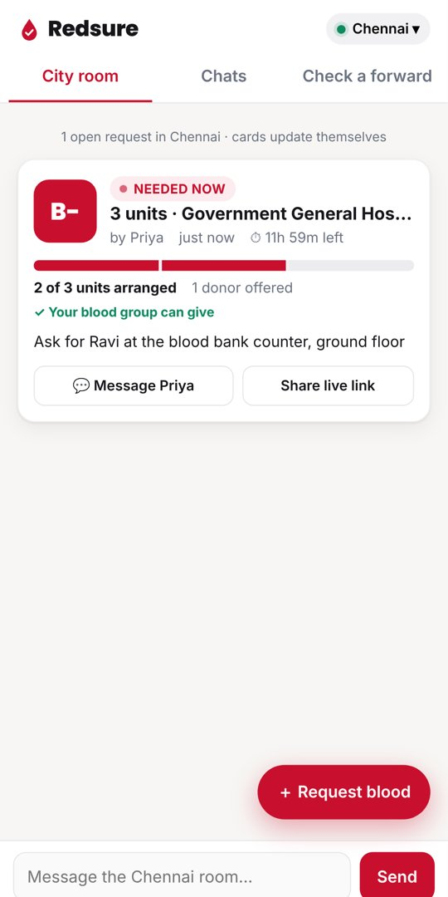
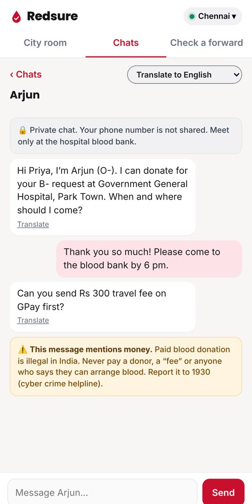
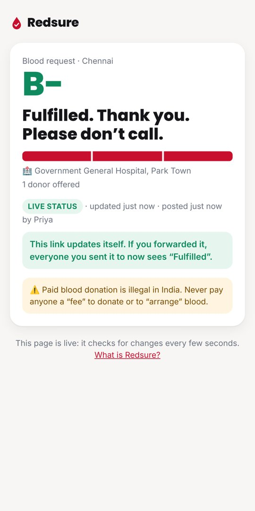
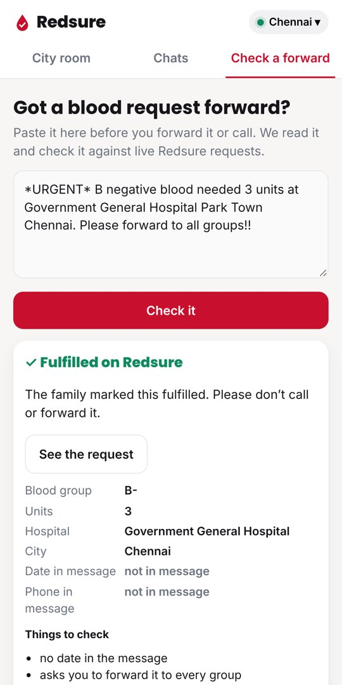

<p align="center">
  
</p>

<h1 align="center">Redsure</h1>
<p align="center"><b>The blood request that knows when it's done.</b></p>

<p align="center">
  <a href="https://redsure.onrender.com"><b>Live app</b></a> ·
  <a href="docs/Redsure_demo.mp4">Demo video</a> ·
  <a href="docs/Redsure_Writeup.pdf">Write-up (PDF)</a> ·
  <a href="https://redsure.onrender.com/stats">Live usage</a><br>
  Nexconn App Key: <code>8brlm7uf89223</code> · Track: Humanitarian &amp; Social Good · Nexconn Build Challenge 2026
</p>

<p align="center">
  
  
  
  
</p>

## The problem

When a family needs blood, they post *"URGENT! B-ve blood needed, call this number, please forward"* in every WhatsApp group. That message is a **frozen copy**: it can never say "done".

- Old requests keep circulating for years. A 2015–16 blood-donor list went viral again in 2020 and 2021 (Alt News, The Quint, NewsMeter fact-checks).
- The family's phone keeps ringing after the need is over, and scammers use the number to ask for "fees". Paid donation has been illegal in India since 1998, yet Kerala Police warned of rising blood-donation scams in July 2025.
- Donors learn to ignore every request, including the real one tonight.

On paper India now collects about as much blood as it needs (14.6 million units in 2024–25, ORF). What breaks is the **message**. That's a communication problem, and a chat platform can fix it.

## What Redsure does

| | |
|---|---|
| 🔴 **One live card** | The family posts once. The card's status, *needed → 1 of 3 arranged → Fulfilled, please don't call*, updates instantly for everyone in the city room. |
| 🔗 **A link that stays true** | They share a live link instead of a frozen text. Anyone who opens it, even days later, sees the current status; the WhatsApp preview shows it too. |
| 🔒 **Private donor chat** | "I can donate" opens a 1-to-1 chat with the family, with typing indicators and translation. No phone numbers are ever shown. |
| ⚠️ **Never-pay guard** | Any message mentioning money, UPI or a "fee" gets a warning on both sides. |
| 🔍 **Check a forward** | Paste any forward you received. Redsure reads it (AI + rules), flags missing dates and fee requests, and tells you if it matches a live, fulfilled or unknown request. It never calls a request "fake". |
| ⏱ **Closes itself** | Requests expire at their deadline unless the family extends them. |

### Try it in 2 minutes (for reviewers)

1. Open **https://redsure.onrender.com**, enter a first name, pick **Chennai**, tap **Continue**. This is the family.
2. Open the same link in a **second, incognito window**, enter another name, pick **Chennai**, blood group **O-**. This is the donor.
3. Family: **Request blood** → B-, 3 units, any hospital → **Post live request**. The card appears on the donor's screen instantly.
4. Donor: **I can donate**. A private chat opens and the family's card shows "1 donor offered".
5. Family: tap **+1 unit arranged** three times. Both screens turn green: *Fulfilled, please don't call*. Open the shared link: it says the same.
6. Donor: **Check a forward** → paste any blood-request forward.

## How it uses Nexconn

| Feature | Nexconn capability | Code |
|---|---|---|
| Live request card | **Custom message type** `RS:Request`, registered in the Web Chat SDK (`registerCustomMessages`), sent by our server with metadata via Platform Chat API `group-channel/message/send` (`hasMetadata`, `isEchoToSender`) | `server/index.js` `/api/requests/create` |
| Status that changes in place | **Message metadata** updated via `message/metadata/set`; every client receives `MessageHandler.onMessageMetadataUpdated` | `/api/requests/pledge`, `/update`; `web/src/main.js` `initEngine` |
| Live share page + link preview | `message/metadata/list`: Nexconn metadata is the only database | `/api/public`, `/r/:room/:message` |
| City rooms | **Group channels**: `group-channel/create`, `/join`, `GroupChannel.sendMessage`, room text chat | `ensureRoom`, `renderRoom` |
| Requests visible to late joiners | Room index stored in the group profile (`group-channel/profile/update`, `/profile/list`) | `getRoomIndex`, `/api/rooms/:id/cards` |
| Room history | `BaseChannel.createMessagesQuery` | `joinRoom` |
| Donor ↔ family chat | **Direct channels**, `createChannelsQuery`, unread counts | `sendDm`, `loadDms` |
| Typing indicator | `DirectChannel.sendTypingStatus` + `ChannelHandler.onTypingStatusChanged` | `renderThread` |
| Translation | **Built-in translation** `translateModule.translateMessages` + `TranslateHandler` (AI fallback when the app's translation service is off) | `renderThread`, `/api/translate` |
| Login without passwords | Server-issued **access tokens** `auth/access-token/issue`, SHA1-signed requests, automatic token refresh | `server/nexconn.js`, `startSession` |
| Reliability | `ConnectionStatusHandler`; primary/backup API domain failover (5 s) | `server/nexconn.js` |

## Architecture

```
Phone browser ── Nexconn Chat SDK (WebSocket: send / receive / metadata events) ──► Nexconn Chat cloud
     │  session · create · pledge · update · check                                   ▲
     ▼                                                                               │ signed Platform Chat API
Redsure server (Node/Express) ───────────────────────────────────────────────────────┘
     ├─ App Secret stays here; issues user tokens
     ├─ single writer of counts (two donors tapping at once can't overwrite each other)
     ├─ /r/<room>/<message>: live public page + link-preview tags from message metadata
     └─ Groq LLM (optional): reads pasted forwards; keeps only values that appear in the text
```

**Design choices**
- **Nexconn is the only database.** Card state lives in message metadata; each room's card list lives in the group profile. No extra datastore, nothing to lose on restart.
- **The server posts cards.** It validates input (no phone numbers or money in notes), sets the owner and starts the metadata, so ownership can't be forged. Only the family can change progress.
- **Group members only receive messages sent after they join**, so the room index lets people who join later still see open requests.

## Early users

Shared with friends on WhatsApp on 21 Nov 2026; 12 people joined city rooms within a few hours. Live count, with our own test accounts excluded: **https://redsure.onrender.com/stats**

## Safety and privacy

- No phone numbers anywhere: notes are checked, and donors and families talk in in-app chats.
- Never labels a request "fake"; says what it can and can't confirm.
- AI-extracted values are kept only if they appear in the pasted text (no invented details).
- Paid donation warning on any money mention, with the 1930 cyber-crime helpline.
- Requests expire by default.

## Run it locally

```bash
npm install
cp .env.example .env          # NEXCONN_APP_KEY, NEXCONN_APP_SECRET, optional GROQ_API_KEY
npm run build
node --env-file=.env server/index.js     # http://localhost:3000
npm test                                 # logic + server boot tests
```

Deploy: `render.yaml` (Render → New → Blueprint). A GitHub Actions workflow pings the app every 10 minutes so the free instance doesn't sleep.

```
server/   index.js (API + live pages) · nexconn.js (signed Platform API client) · forward.js (forward reader) · shared.js
web/      index.html · src/main.js (Chat SDK client) · src/style.css
docs/     write-up PDF, demo video, screenshots
test/     node:test suite
```

## Roadmap

1. Verified rooms for blood banks and hospitals ("confirmed by blood bank" badge).
2. Donor alerts by blood group using Nexconn targeted group messages and push.
3. The same live card for platelets, oxygen and rare medicines.
4. Android app with the Nexconn Flutter SDK.

## Prior work

Built from scratch for the Nexconn Build Challenge 2026.

## License

MIT
